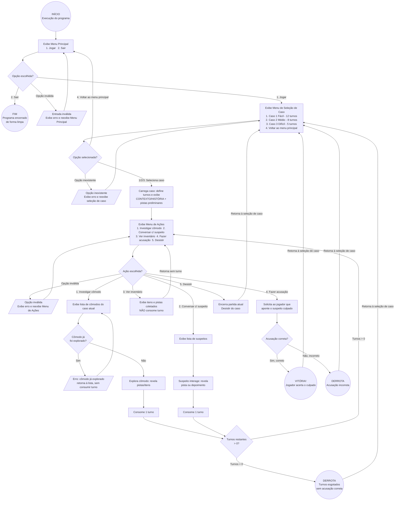

# Título do Projeto: Jogo de Detetive

## 1. Descrição do Sistema

O projeto consiste em um sistema de jogo de investigação desenvolvido em linguagem C. O sistema permitirá que o jogador escolha entre diferentes casos, cada um com um nível de dificuldade e uma quantidade específica de turnos para solucionar o mistério. Durante a investigação, o jogador poderá explorar cômodos, conversar com suspeitos, coletar pistas e consultar o inventário para reunir informações que auxiliem na descoberta do culpado.

O foco principal é proporcionar uma experiência de investigação baseada na tomada de decisões e no gerenciamento de turnos. Ao longo da partida, o jogador deverá analisar as informações obtidas, definir suas ações e administrar os recursos disponíveis para avançar na investigação. O sistema acompanhará o progresso da partida e, ao final, avaliará a decisão do jogador, determinando o desfecho do caso. Entradas inválidas serão tratadas de forma adequada, mantendo a continuidade e a organização da navegação entre as etapas do jogo.

---

## 2. Fluxo de Utilização Esperado para o Sistema

O fluxo apresentado a seguir representa o funcionamento planejado para o sistema durante as próximas etapas de desenvolvimento. As funcionalidades serão implementadas gradualmente conforme os conteúdos da disciplina forem apresentados e estudados. A versão atual do código contempla apenas parte dessas funcionalidades, de acordo com os conceitos já abordados em aula.

1. Ao iniciar o programa, o usuário visualizará o menu principal com as opções:
   - `1. Jogar`
   - `2. Sair`
2. Caso o usuário escolha `Jogar`, o sistema exibirá o menu de seleção de caso, apresentando a lista de níveis disponíveis com a quantidade de turnos de cada um:
   - `1. Caso 1 (Fácil) - 12 turnos`
   - `2. Caso 2 (Médio) - 8 turnos`
   - `3. Caso 3 (Difícil) - 5 turnos`
   - `4. Voltar ao menu principal`
3. Ao selecionar um caso, o usuário visualizará o contexto/história inicial junto ao menu de ações da investigação:
   - **CONTEXTO - HISTÓRIA** (exibe a narração inicial e as pistas preliminares do caso)
   - `1. Investigar um cômodo`
   - `2. Conversar com um suspeito`
   - `3. Ver inventário`
   - `4. Fazer uma acusação`
   - `5. Desistir do caso`
4. Ao escolher `Investigar um cômodo`, o sistema exibirá a lista de cômodos do caso. Ao selecionar e explorar um cômodo, o jogador poderá encontrar pistas e itens que são adicionados ao inventário. Essa ação consome 1 turno da investigação.
5. Ao escolher `Conversar com um suspeito`, o sistema apresentará a lista de suspeitos disponíveis. Ao interagir, o suspeito pode revelar pistas ou depoimentos que auxiliam na resolução. Essa ação consome 1 turno da investigação.
6. Ao escolher `Ver inventário`, o jogador consulta todos os itens e pistas já coletados durante a investigação. Essa consulta não consome turno.
7. Quando o jogador optar por `Fazer uma acusação`, o sistema solicitará que aponte o culpado entre os suspeitos. Se a acusação estiver correta, o jogador vence o jogo; se estiver incorreta, o caso é encerrado como derrota.
8. Caso escolha `Desistir do caso`, o jogador encerra a partida atual e retorna à tela de seleção de caso.
9. O sistema controla rigorosamente o limite de turnos de cada caso. Ações de investigação consomem turnos; se os turnos se esgotarem sem uma acusação correta, o jogo termina com derrota e exibe a mensagem de fim de jogo.
10. As operações de erro (entradas inválidas, opções inexistentes ou cômodos já explorados) exibirão mensagens claras e retornarão o usuário ao menu correspondente, sem perda do progresso da sessão.
11. Ao escolher `Sair` no menu principal, o programa é encerrado de forma limpa.

---

## 3. Fluxograma da Lógica do Sistema

---

## 4. Estrutura de Dados

Na versão atual, o sistema não utiliza estruturas heterogêneas (`struct`). Os dados são
organizados com variáveis simples, constantes e um vetor de strings (matriz de caracteres),
de acordo com os conteúdos vistos até o momento na disciplina.

### 4.1 Variáveis globais (controle da investigação)

| Variável | Tipo | Arquivo | Função |
|---|---|---|---|
| `historia` | `int` | `main.c` | Caso escolhido pelo jogador (1, 2 ou 3) |
| `turnos` | `int` | `main.c` | Turnos restantes: 12 (Fácil), 8 (Médio) ou 5 (Difícil) |
| `inventario` | `char[10][40]` | `inventario.h` | Nomes dos itens/pistas encontrados |
| `total_itens` | `int` | `inventario.h` | Quantidade de itens no inventário (também conta como número de provas) |

```c
#define MAX_ITENS 10

int historia;                      // caso escolhido (1, 2 ou 3)
int turnos;                        // turnos restantes

char inventario[MAX_ITENS][40];    // cada linha guarda o nome de um item
int total_itens = 0;               // quantos itens foram coletados
```

### 4.2 Variáveis locais

- `char nome[30]`: nome do detetive, lido em `iniciar_jogo()`.
- `int opcao`, `pessoa`, `comodo`, `local`, `suspeito`: guardam a opção digitada em cada menu
  e são usadas no `switch` correspondente.

### 4.3 Organização dos casos

Os dados de cada caso (história, personagens, cômodos, pistas e culpado) ficam na biblioteca
`historias.h`, separados em quatro funções por caso:

| Função | Responsabilidade |
|---|---|
| `historiaX_introducao()` | Exibe o contexto e a lista de suspeitos |
| `historiaX_investigar()` | Exibe os cômodos; cada `case` mostra a pista e chama `adicionar_item()` |
| `historiaX_conversar()` | Exibe o depoimento de cada suspeito |
| `historiaX_acusacao()` | Verifica o suspeito escolhido e se há provas suficientes |

As funções `investigar()` e `conversar()` retornam `1` quando a ação gasta um turno e `0`
quando a opção é inválida, e esse valor é subtraído de `turnos`.

### 4.4 Inventário (`inventario.h`)

| Função | O que faz |
|---|---|
| `limpar_inventario()` | Zera `total_itens` ao iniciar um novo caso |
| `adicionar_item(item)` | Copia o item para a matriz com `strcpy`, evitando repetidos com `strcmp` |
| `mostrar_inventario()` | Percorre a matriz com `for` e exibe os itens coletados |

Para resolver o caso, além de acusar o culpado certo, o jogador precisa de um número mínimo de
itens no inventário: 4 no Caso 1 e 3 nos Casos 2 e 3.

### 4.5 Evolução planejada

Quando o conteúdo de estruturas heterogêneas for apresentado na disciplina, os dados acima
poderão ser agrupados em `struct`, como `Caso`, `Personagem`, `Pista`, `Comodo` e `Investigacao`.
