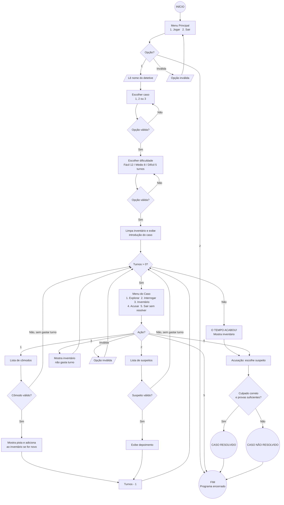

# Título do Projeto: Jogo de Detetive

## 1. Descrição do Sistema

O projeto consiste em um sistema de jogo de investigação desenvolvido em linguagem C. O sistema permite que o jogador escolha entre três casos e um nível de dificuldade, que define a quantidade de turnos para solucionar o mistério. Durante a investigação, o jogador pode explorar cômodos, conversar com suspeitos, coletar pistas e consultar o inventário para reunir informações que auxiliem na descoberta do culpado.

O foco principal é proporcionar uma experiência de investigação baseada na tomada de decisões e no gerenciamento de turnos. Ao longo da partida, o jogador deve analisar as informações obtidas, definir suas ações e administrar os recursos disponíveis para avançar na investigação. O sistema acompanha o progresso da partida e, ao final, avalia a decisão do jogador, determinando o desfecho do caso. Entradas inválidas são tratadas de forma adequada, mantendo a continuidade e a organização da navegação entre as etapas do jogo.

---

## 2. Fluxo de Utilização do Sistema

1. Ao iniciar o programa, o usuário visualiza o menu principal com as opções:
   - `1. Jogar`
   - `2. Sair`
2. Ao escolher `Jogar`, o sistema pede o **nome do detetive**, que fica visível durante toda a partida.
3. Em seguida, o jogador escolhe o **caso** que vai investigar:
   - `1. Caso 01 - O Assassinato da Mansão Oliveira`
   - `2. Caso 02 - O Roubo do Museu Municipal`
   - `3. Caso 03 - O Envenenamento no Trem Noturno`
4. Depois, escolhe a **dificuldade**, que define a quantidade de turnos (independente do caso escolhido):
   - `1. Fácil - 12 turnos`
   - `2. Médio - 8 turnos`
   - `3. Difícil - 5 turnos`
5. O sistema exibe a introdução do caso (contexto da história e lista de suspeitos) e, em seguida, o menu do caso, que mostra o nome do detetive, os turnos restantes e a quantidade de provas coletadas:
   - `1. Explorar os locais (gasta 1 turno)`
   - `2. Interrogar um suspeito (gasta 1 turno)`
   - `3. Ver inventário`
   - `4. Acusar um suspeito (encerrar o caso)`
   - `5. Sair sem resolver`
6. Ao escolher `Explorar os locais`, o sistema exibe a planta do local e a lista de cômodos. Ao investigar um cômodo, o jogador encontra uma pista, que é adicionada ao inventário. Essa ação consome 1 turno. Se o item já estiver no inventário, ele não é adicionado novamente.
7. Ao escolher `Interrogar um suspeito`, o sistema apresenta a lista de suspeitos e exibe o depoimento do escolhido. Essa ação consome 1 turno.
8. Ao escolher `Ver inventário`, o jogador consulta os itens coletados e o total de provas. Essa consulta **não** consome turno.
9. Ao escolher `Acusar um suspeito`, o jogador aponta o culpado. O caso só é resolvido se:
   - o suspeito acusado for o culpado **e**
   - o inventário tiver o número mínimo de provas (4 no Caso 1; 3 nos Casos 2 e 3).

   Caso contrário, o caso é encerrado como não resolvido. Após a acusação, o programa é encerrado.
10. Ao escolher `Sair sem resolver`, o programa é encerrado.
11. Quando os turnos chegam a zero, o sistema exibe a mensagem **"O TEMPO ACABOU!"**, mostra o inventário e obriga o jogador a fazer a acusação com as provas que possui.
12. Entradas inválidas são tratadas da seguinte forma:
    - na escolha de caso e de dificuldade, o sistema exibe "Opção inválida!" e repete a pergunta;
    - nos menus de cômodos e de suspeitos, exibe "Opção inválida!" e retorna ao menu do caso **sem gastar turno**;
    - no menu do caso, exibe "Opção inválida!" e reexibe o menu;
    - no menu principal, exibe "Opção inválida!" e reexibe o menu.

---

## 3. Fluxograma da Lógica do Sistema

---

## Como compilar e executar

O jogo foi feito para o terminal do **Windows** (usa `system("cls")` para limpar a tela).

```bash
cd "Codigo fonte"
gcc main.c -o jogo
jogo.exe
```

---

## 4. Estrutura de Dados

O sistema não utiliza estruturas heterogêneas (`struct`). Os dados são
organizados com variáveis simples, constantes e um vetor de strings (matriz de caracteres),
de acordo com os conteúdos vistos até o momento na disciplina.

### 4.1 Variáveis globais (controle da investigação)

| Variável | Tipo | Arquivo | Função |
|---|---|---|---|
| `historia` | `int` | `main.c` | Caso escolhido pelo jogador (1, 2 ou 3) |
| `turnos` | `int` | `main.c` | Turnos restantes: 12 (Fácil), 8 (Médio) ou 5 (Difícil) |
| `inventario` | `char[10][40]` | `inventario.h` | Nomes dos itens/pistas encontrados |
| `total_itens` | `int` | `inventario.h` | Quantidade de itens no inventário (também conta como número de provas) |

```c
#define MAX_ITENS 10

int historia;                      // caso escolhido (1, 2 ou 3)
int turnos;                        // turnos restantes

char inventario[MAX_ITENS][40];    // cada linha guarda o nome de um item
int total_itens = 0;               // quantos itens foram coletados
```

### 4.2 Variáveis locais

- `char nome[30]`: nome do detetive, lido em `iniciar_jogo()`.
- `int opcao`, `pessoa`, `comodo`, `local`, `suspeito`: guardam a opção digitada em cada menu
  e são usadas no `switch` correspondente.

### 4.3 Organização dos casos

Os dados de cada caso (história, personagens, cômodos, pistas e culpado) ficam na biblioteca
`historias.h`, separados em quatro funções por caso:

| Função | Responsabilidade |
|---|---|
| `historiaX_introducao()` | Exibe o contexto e a lista de suspeitos |
| `historiaX_investigar()` | Exibe os cômodos; cada `case` mostra a pista e chama `adicionar_item()` |
| `historiaX_conversar()` | Exibe o depoimento de cada suspeito |
| `historiaX_acusacao()` | Verifica o suspeito escolhido e se há provas suficientes |

As funções `investigar()` e `conversar()` retornam `1` quando a ação gasta um turno e `0`
quando a opção é inválida, e esse valor é subtraído de `turnos`.

### 4.4 Inventário (`inventario.h`)

| Função | O que faz |
|---|---|
| `limpar_inventario()` | Zera `total_itens` ao iniciar um novo caso |
| `adicionar_item(item)` | Copia o item para a matriz com `strcpy`, evitando repetidos com `strcmp` |
| `mostrar_inventario()` | Percorre a matriz com `for` e exibe os itens coletados |

Para resolver o caso, além de acusar o culpado certo, o jogador precisa de um número mínimo de
itens no inventário: 4 no Caso 1 e 3 nos Casos 2 e 3.

### 4.5 Evolução planejada

Quando o conteúdo de estruturas heterogêneas for apresentado na disciplina, os dados acima
poderão ser agrupados em `struct`, como `Caso`, `Personagem`, `Pista`, `Comodo` e `Investigacao`.
